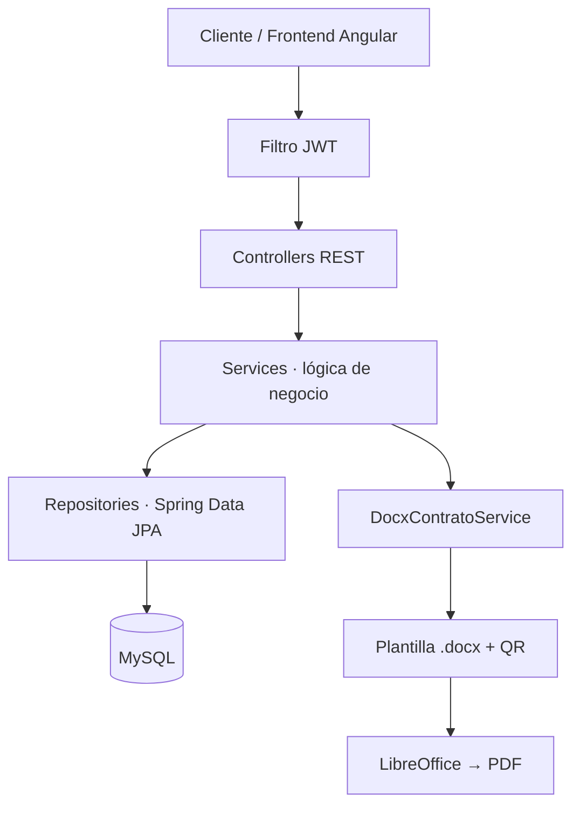

<div align="center">

# Sociedad Humanista Santa Martha

### Plataforma de Gestión de Previsión Funeraria · API REST

*Contratos, pagos y cobros programados — con firma digital respaldada por video de consentimiento.*


</div>

---

## Contenido

[Visión general](#visión-general) · [Contratos en PDF](#contratos-en-pdf) · [Arquitectura](#arquitectura) · [Stack](#stack-tecnológico) · [Inicio rápido](#inicio-rápido) · [Configuración](#configuración) · [Docker](#docker) · [API](#api) · [Seguridad](#seguridad) · [Estructura](#estructura-del-proyecto)

---

## Visión general

Backend de **Sociedad Humanista Santa Martha, S.A. de C.V.** para administrar de punta a punta el ciclo de vida de sus servicios de previsión funeraria:

| | Capacidad |
|---|---|
| **Clientes** | Personas, titulares, beneficiarios y documentos |
| **Contratos** | Cuatro modalidades con generación automática en PDF |
| **Cobranza** | Pagos, calendario de cuotas y cobros programados |
| **Catálogo** | Planes funerarios, tarifas y artículos |
| **Comunicación** | Notificaciones por correo y webhook de WhatsApp |
| **Control** | Autenticación JWT, roles y auditoría de registros |

---

## Contratos en PDF

Cada contrato se genera a partir de la plantilla `.docx` oficial, rellenada con los datos del cliente y convertida a **PDF** con LibreOffice.

| Modalidad | `tipoPlan` | Plantilla |
|---|---|---|
| Mutualista | `MUTUALISTA` | `mutualista.docx` |
| Previsión de Humanos | `HUMANOS` | `previsionhumanos.docx` |
| Mutualista de Mascotas | `MUTUALISTA_MASCOTAS` | `mutualistamascotas.docx` |
| Previsión de Mascotas | `MASCOTAS` | `previsionmascotas.docx` |

**Características**

- Datos del cliente resaltados en **negritas**.
- Secciones opcionales (p. ej. beneficiarios) que aparecen únicamente cuando existen.
- **Código QR como aval de firma:** enlaza a la descarga del video de consentimiento grabado por el cliente.
- El enlace del QR está firmado con **HMAC-SHA256**, por lo que no puede alterarse ni adivinarse.

```
GET /api/contratos/{id}/pdf                          → Descarga el contrato (autenticado)
GET /api/contratos/{id}/video-consentimiento?firma=… → Video de consentimiento (enlace firmado del QR)
```

---

## Arquitectura

Arquitectura en capas sobre una API REST sin estado.



| Patrón | Aplicación |
|---|---|
| DTO | Desacopla las entidades del contrato de la API |
| Repository | Acceso a datos con Spring Data JPA |
| Template Method | `BaseEntity` con campos comunes |
| Chain of Responsibility | Filtros de seguridad (`JwtAuthenticationFilter`) |
| Global Exception Handler | `@RestControllerAdvice` centraliza los errores |

---

## Stack tecnológico

| Capa | Tecnología |
|---|---|
| Lenguaje | Java 21 |
| Framework | Spring Boot 3.4 (Web, Data JPA, Security, Validation, Mail) |
| Persistencia | MySQL 8 · Hibernate |
| Autenticación | JWT (jjwt 0.12) · BCrypt |
| Documentos | Plantillas DOCX · LibreOffice · OpenPDF |
| Código QR | ZXing 3.5 |
| Utilidades | Lombok |
| Build | Maven 3 |
| Contenedor | Docker (LibreOffice y fuentes incluidos) |

---

## Inicio rápido

**Requisitos:** Java 21, Maven 3, MySQL 8 y LibreOffice (`soffice`) para generar PDFs en local.

```bash
# 1. Clonar
git clone https://github.com/tu-usuario/provisiones-santa-martha-api.git
cd provisiones-santa-martha-api

# 2. Base de datos
mysql -u root -p -e "CREATE DATABASE shsm_db CHARACTER SET utf8mb4 COLLATE utf8mb4_unicode_ci;"

# 3. Variables de entorno (ver tabla siguiente)
export DB_URL=jdbc:mysql://localhost:3306/shsm_db
export DB_USERNAME=root
export DB_PASSWORD=tu_password
export JWT_SECRET=una_clave_larga_y_segura
export PORT=8080

# 4. Ejecutar
mvn clean install
mvn spring-boot:run
```

La API queda disponible en `http://localhost:8080/api`.

---

## Configuración

| Variable | Descripción |
|---|---|
| `DB_URL` · `DB_USERNAME` · `DB_PASSWORD` | Conexión a MySQL |
| `JWT_SECRET` | Clave de firma de tokens y de los enlaces del QR |
| `MAIL_HOST` · `MAIL_PORT` · `MAIL_USERNAME` · `MAIL_PASSWORD` | Servidor SMTP |
| `PORT` | Puerto HTTP |
| `PUBLIC_API_URL` | URL pública del backend (incluye `/api`). **Obligatoria en producción** para que el QR apunte al video |

> Nunca subas credenciales al repositorio; usa variables de entorno o un gestor de secretos.

---

## Docker

La imagen incluye LibreOffice, `fontconfig` y fuentes (Liberation y Noto) necesarias para la conversión a PDF.

```bash
docker build -t shsm-api .
docker run -p 8080:8080 --env-file .env shsm-api
```

---

## API

Prefijo base: `/api`. Todo requiere token JWT salvo `/auth/**` y el enlace firmado del video de consentimiento.

| Recurso | Controlador |
|---|---|
| Autenticación | `AuthController` |
| Personas | `PersonaController` |
| Contratos y PDF | `ContratoController` |
| Planes funerarios | `PlanFunerarioController` |
| Pagos y cobros | `PagoController` · `CobroController` |
| Tarifas y catálogo | `TarifaController` · `CatalogoController` |
| Documentos y OCR | `DocumentoController` · `OcrController` |
| Notificaciones | `NotificacionController` · `WhatsAppWebhookController` |
| Panel y usuarios | `PanelController` · `UsuarioController` |

```http
Authorization: Bearer <token>
```

---

## Seguridad

- Autenticación **stateless** con JWT y contraseñas con **BCrypt**.
- Enlaces del video de consentimiento firmados con **HMAC-SHA256**.
- Auditoría de operaciones sobre registros.
- Los secretos se inyectan siempre por variables de entorno.

---

## Estructura del proyecto

```
src/main/
├── java/com/shsm/api/
│   ├── config/          Seguridad y configuración
│   ├── controller/      Endpoints REST
│   ├── dto/             Objetos de transferencia
│   ├── entity/          Entidades JPA
│   ├── exception/       Manejo global de errores
│   ├── repository/      Spring Data JPA
│   ├── security/        Filtros y utilidades JWT
│   └── service/         Lógica de negocio (incl. DocxContratoService)
└── resources/
    ├── application.yml
    └── contratos/       Plantillas .docx de los cuatro contratos
```

---

<div align="center">

**Sociedad Humanista Santa Martha, S.A. de C.V.** · Poza Rica, Veracruz

Software de uso privado. Todos los derechos reservados.

</div>
